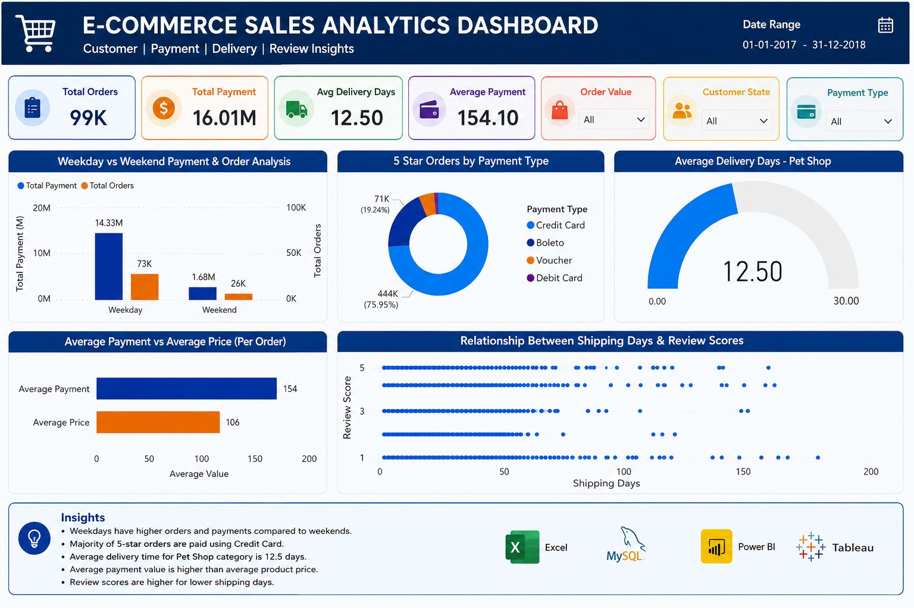

# E-Commerce Sales Customer Analytics

## 📊 Project Overview
This project focuses on analyzing e-commerce sales, customer behavior, payment patterns, product performance, and delivery trends using multiple data analytics tools.

The project transforms raw data into meaningful insights through data cleaning, analysis, SQL queries, and interactive dashboards.

## 🛠️ Tools & Technologies
- Microsoft Excel
- MySQL
- Power BI
- Tableau

## 📈 Key Analysis Performed
- Weekday vs Weekend Payment Analysis
- Payment Type Analysis
- Product Category Performance
- Customer Behavior Analysis
- Average Delivery Days Analysis
- Average Payment vs Product Price Analysis
- Monthly Order Trends
- Sales Performance Analysis

## 📊 Dashboards

### Excel Dashboard

[📥 Download Excel Project](https://docs.google.com/spreadsheets/d/1PUg4lcDryDF5NdGmGa1b7m3XzLaQ-KUm/edit?usp=sharing&ouid=108201821931776483277&rtpof=true&sd=true)

### Power BI Dashboard

[📥 Download PowerBI Project](https://drive.google.com/file/d/1DeZzBXO3xo-5XzpnWWchmej-i43y2qCF/view?usp=sharing)

### Tableau Dashboard

[📥 Download Tableau Project](https://drive.google.com/file/d/11VQF-p4v0lhWvyAtiRvUgtTC9I_ayogh/view?usp=sharing)

## 🔍 Key Insights
- Weekday orders and payments performed better compared to weekends.
- Credit Card was the most preferred payment method.
- Different product categories showed varying order volumes.
- Delivery time varied across product categories.
- Monthly trends revealed changes in customer purchasing behavior.
- The dashboards help support data-driven business decisions.

## 👩‍💻 Author
*Rajasree Vankadoth*

Aspiring Data Analyst | Excel | MySQL | Power BI | Tableau
